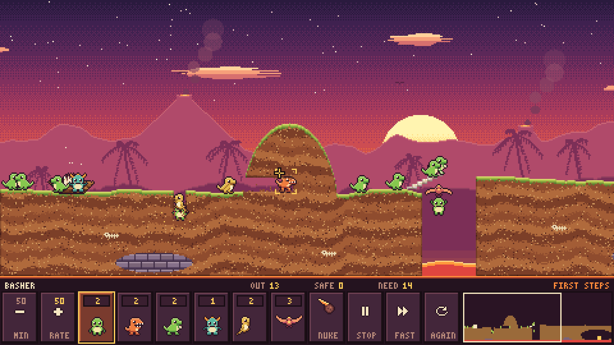
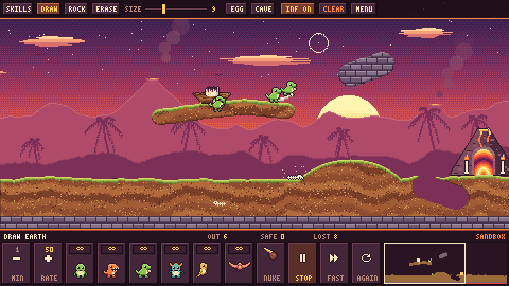

# Dino Drop

A Lemmings-style herding sandbox with dinosaurs. It's one self-contained `index.html`: a canvas game with inline JS and CSS. It loads no external assets, fonts, or CDNs, and every sprite, the font, the terrain and the backdrop are drawn in code.




## Run

Open `index.html` in any modern browser by double-clicking it (`file://` works). No server and no build step.

The game renders at 480×270 logical pixels and scales up by whole multiples to fit the window (`image-rendering: pixelated`).

## Goal

Dinos hatch from the egg in the nest and walk forward without stopping. Give them skills to get enough of them into the glowing volcano cave before they fall too far, walk into lava, or go extinct.

## Skills (limited per level)

| # | Skill | Dino | What it does |
|---|-------|------|--------------|
| 1 | **Dig** | green | Digs straight down through earth. Stops at rock. |
| 2 | **Bash** | orange T-rex | Smashes a horizontal tunnel through earth. Stops and turns at rock. |
| 3 | **Build** | green | Lays 12 bone steps up and forward, then shrugs. |
| 4 | **Block** | teal stegosaurus | Stands still and turns other dinos around. |
| 5 | **Climb** | yellow raptor | Permanent. Climbs vertical walls. |
| 6 | **Glide** | pterodactyl buddy | Permanent. Floats down safely from any height. |
| 7 / N | **Meteor (nuke)** | — | Double-click it. Every dino gets a countdown, then a meteor hits it (it blasts terrain too). |

A fall of more than about 62 px turns a dino into a fossil. Walls taller than 6 px turn walkers around, unless they can climb.

## Controls

**Mouse**
- Click a skill button (or press 1–6), then click a dino. A gold bracket shows which dino you'll hit.
- **RATE − / +** sets the release rate. You can hold it down; you can't go below the level's starting rate.
- **NUKE** must be clicked twice to confirm. **STOP** pauses, **FAST** runs at 3× speed, and **AGAIN** restarts.
- Click or drag the minimap to scroll. You can also scroll by pushing the mouse against the screen edge.

**Keyboard**
- `1`–`6`: pick a skill (dig, bash, build, block, climb, glide)
- `N` / `7`: nuke (press twice)
- `P` / `Space`: pause
- `F`: fast-forward
- `R`: restart
- `-` / `=`: release rate
- `←` `→` / `A` `D`: scroll
- `Esc`: back to the menu
- Menu: `1` First Steps, `2` Magma Canyon, `S` Sandbox
- Result screen: `Enter` continue, `R` retry, `Esc` menu

**Sandbox** (top bar or keys)
- `B` DRAW earth, `K` ROCK (indestructible), `E` ERASE: click and drag to paint
- **SIZE** slider, or `[` `]`, sets the brush radius (2–24)
- `G` EGG / `X` CAVE: click to move the spawn or exit. Both snap down onto the ground.
- `Q` SKILLS: go back to assigning skills
- `U` INF ON/OFF: unlimited skills (on by default; off gives 10 of each)
- **CLEAR** resets the terrain. **AGAIN** restarts the herd but keeps your drawing.

## Levels

1. **First Steps**: save 14 of 20. Bridge the lava gap, then dig into the cave under the far plateau.
2. **Magma Canyon**: save 20 of 30. Dig down through the overhang (walking off its edge is fatal), bridge the lava, then bash under the rock pillar.

Both levels were checked by scripted runs (`tests/solve_levels.py`). Level 1 can be won with one build and one dig (17 saved). Level 2 can be won with one dig, one build and one bash (20 saved; blockers help).

## Tests (optional)

These need Python Playwright with Chromium. Set `CHROME=/path/to/chrome` to use a system Chrome.

```
python3 tests/verify.py         # menu, real mouse clicks for dig/build, nuke, result, level 2, sandbox draw/rock/erase/egg/cave; fails on console errors; writes screenshots/sandbox.png
python3 tests/solve_levels.py   # scripted solutions for both levels
python3 tests/gameplay_shot.py 64   # stages screenshots/gameplay.png
```

The page exposes `window.DINO` (state, `step(n)`, `assign`, `toClient`, …) for these scripts.

## Originality

All code and art here is original. Sprites are inline character-grid pixel art; the 3×5 font, the terrain textures and the parallax backdrop are generated procedurally. Nothing is taken from Lemmings. The open-source Pingus was used only as a general reference for how this genre's mechanics behave; none of its code or assets are used.
